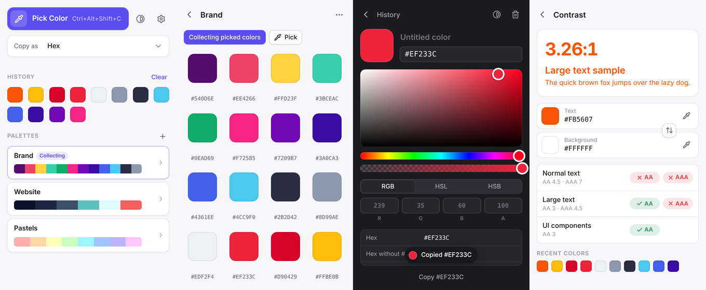
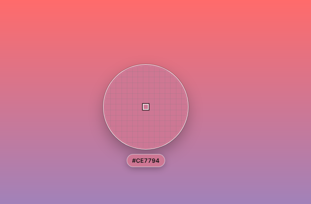

# ChipDeck

A fast, unobtrusive color picker for **macOS** and **Windows**. It lives in the menu bar / system tray,
picks any pixel on any screen with a magnifying loupe, keeps a history, organizes palettes and
copies colors in the format you need.



## Features

- **Picker with loupe**: global shortcut, pixel-precise loupe, arrow keys for 1 px / 10 px steps,
  scroll wheel or `+`/`-` to resize, `Alt` with the scroll wheel or `+`/`-` to zoom, `Shift`-click to
  pick several colors in one go.
  Every pick starts with the default loupe size and zoom; the bigger or further zoomed in the
  loupe, the slower the mouse, so single pixels stay easy to hit. Works across multiple displays
  and HiDPI screens.
- **History & palettes**: every pick lands in the history and is copied to the clipboard. Palettes
  can collect picked colors automatically, and colors can be dragged between them (hold `Alt` to copy).
  Palettes export as JSON, CSS and SCSS variables, a Tailwind config or a GIMP/Inkscape palette.
- **Color panel**: saturation/brightness area, hue and opacity sliders, RGB/HSL/HSB inputs, names and
  17 copy formats (CSS Hex/RGB/HSL/OKLCH, SwiftUI, UIColor, NSColor, Android XML/Compose, Flutter,
  .NET, Java, Unity, OpenGL, …).
- **Contrast checker**: WCAG 2 ratio with AA/AAA results for normal text, large text and UI components.
- Light and dark mode, native vibrancy on macOS, customizable shortcuts, open at login.
- **Distribution**: paid app (one-time purchase, 9.99) in the Mac App Store and the Microsoft Store,
  without in-app purchases. See [docs/STORE.md](docs/STORE.md).

<p align="center"></p>

## Development

Requirements: Node.js 22+, npm 10+, and on macOS / Windows a C++ toolchain (Xcode Command Line
Tools or Visual Studio Build Tools with "Desktop development with C++") for the native screen
sampler. `npm install` builds it; without the toolchain the picker falls back to a frozen screen.

```bash
npm install
npm run dev        # starts Electron with hot reload
npm test           # unit tests (Vitest)
npm run typecheck
npm run native     # rebuilds the native screen sampler (optionally for an arch: -- arm64)
```

The UI can also be opened in a plain browser with an in-memory mock of the Electron bridge, which is
handy for design work: run `npm run dev` and open the renderer URL printed by electron-vite. Query
parameters such as `?route=settings` or `?platform=win32` switch views and platforms.

### Packaging

| Command              | Output                                          | Run on  |
| -------------------- | ----------------------------------------------- | ------- |
| `npm run dist:mac`   | Universal DMG + ZIP (testing only)              | macOS   |
| `npm run dist:mas`   | Mac App Store package (`.pkg`)                  | macOS   |
| `npm run dist:win`   | NSIS installer, x64 + arm64 (testing only)      | Windows |
| `npm run dist:appx`  | Microsoft Store package (`.appx`)               | Windows |
| `npm run icons`      | Regenerates all icons from `scripts/generate-icons.mjs` | any |

Signing, store identifiers and the release checklist are described in [docs/STORE.md](docs/STORE.md).

### Website

Landing page, privacy policy and imprint live in [`site/`](site) (plain HTML/CSS) and are deployed
to GitHub Pages by `.github/workflows/pages.yml` on every push to `main`:
https://mariokernich.github.io/color-picker/

## Architecture

```
src/
  shared/     Pure TypeScript used by every process: color math, formats, contrast,
              state reducer, export, app identity (unit tested)
  main/       Electron main process
    index.ts      App lifecycle, IPC, wiring
    store.ts      JSON persistence of the state in the user data folder
    picker.ts     Full-screen overlay windows per display, live or with a frozen capture
    sampler.ts    Loads the native screen sampler
    windows.ts    Popover window and its placement next to the tray icon
    tray.ts       Menu bar / tray icon and context menu
    shortcuts.ts  Global shortcuts
  preload/    Typed, sandboxed bridges (`window.api`, `window.picker`)
  renderer/   React UI for the popover and a lightweight canvas UI for the picker overlay
native/
  sampler/    N-API addon that reads live screen pixels (GDI on Windows, ScreenCaptureKit on macOS)
```

- The **main process owns the state**. Windows send actions (`src/shared/state.ts`) and receive
  snapshots, so the reducer is the single place where data changes and can be tested in isolation.
- **Picking** covers every display with a transparent overlay that only draws the loupe. While the
  cursor moves, the overlay reads the pixels around it from the native sampler, so the screen stays
  live (videos, animations). The sampler returns exact 8-bit BGRA pixels: Windows reads the composed
  desktop with GDI and hides the overlays from it with `WDA_EXCLUDEFROMCAPTURE`; macOS runs a
  ScreenCaptureKit stream per display that leaves out the app's own windows and converts to sRGB.
  Browser screen capture (`getUserMedia`) is not used on purpose: it goes through YUV video, which
  blurs single pixels. The sampler is built by `scripts/build-native.mjs` on install and for every
  packaged architecture (electron-builder `beforePack`).
- With **Freeze screen while picking** (Settings), or when the sampler is not available, the picker
  captures every display at its native resolution (`desktopCapturer`) and shows that still image.
- On macOS both modes require the *Screen & System Audio Recording* permission, which the app
  explains when it is missing.
- All windows run with `sandbox`, `contextIsolation` and a strict Content Security Policy.

## License

Proprietary, see [LICENSE](LICENSE). The source is public for transparency; building or
distributing the app is not permitted. © Mario Kernich.
